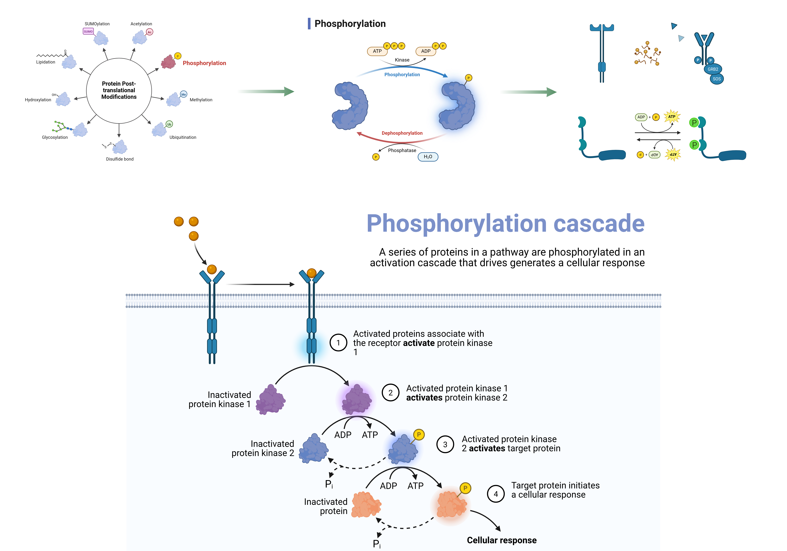
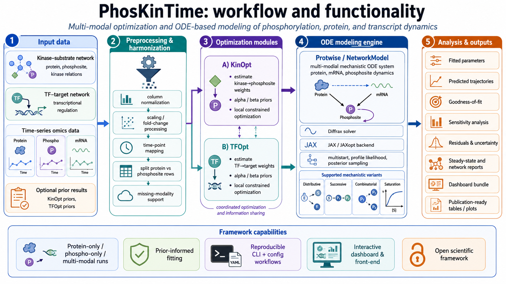

<div align="center">
  

[](https://doi.org/10.5281/zenodo.15351017)


</div> 

--- 

> 💡 **PhosKinTime** is an ODE-based modeling framework for analyzing phosphorylation dynamics over time. It integrates
> parameter estimation, sensitivity analysis, steady-state computation, and visualization tools to help researchers
> explore kinase-substrate interactions in a temporal context.

---

## [Documentation](https://bibymaths.github.io/phoskintime/)

---

## The Problem: Phosphorylation Cascades

In cellular signaling pathways, a series of proteins are phosphorylated in an activation cascade that drives cellular
responses. Understanding these post-translational modifications is critical.



---

## Workflow




---

<details>
<summary>Acknowledgements (Click to expand)</summary>

This project began from my master's thesis work in the Theoretical Biophysics group, now
the [Klipp-Linding Lab](https://rumo.biologie.hu-berlin.de/tbp/index.php/en/), at Humboldt-Universität zu Berlin. The
submitted thesis focused on `kinopt`, while related components of the broader modelling framework were developed in
parallel during that period and continued afterwards.

The implemented version of `kinopt` was developed as the core thesis-stage component and now lives in the standalone
KinOpt repository. The `tfopt` and `protwise`
components were developed by me during the same broader project period and subsequent continuation of the work. The
`networkmodel` component was later designed and implemented independently after that period as an extension of the
original modelling framework.

The initial distributive, successive, and combinatorial ODE formulations came from the thesis-stage modelling framework,
while the saturation model was added independently at a later stage as an extension of the system.

The former subpackage `tfopt`, now the standalone TFOpt tool, is an optimized and extended derivative
of [original work](https://github.com/Normann-BPh/Transcription-Optimization) by my
colleague [Julius Normann](https://github.com/Normann-BPh), adapted with permission.

I am grateful to [Ivo Maintz](https://rumo.biologie.hu-berlin.de/tbp/index.php/en/people/54-people/6-staff/60-maintz)
for generous technical support with server access, package experimentation, and computational setup.

</details>

---

## Overview

PhosKinTime uses ordinary differential equations (ODEs) to model phosphorylation kinetics and supports multiple
mechanistic hypotheses, including:

- **Distributive Model:** Phosphorylation events occur independently.
- **Successive Model:** Phosphorylation events occur sequentially.
- **Combinatorial Model:** Phosphorylation events occur in a hypercube lattice manner.
- **Saturation Model:** Phosphorylation dynamics follow saturating kinetics, where phosphorylation rates approach an
  upper limit as kinase input or substrate availability increases.

--- 

## KinOpt and TFOpt (standalone tools)

KinOpt (kinase-phosphosite optimization) and TFOpt (TF-mRNA optimization) are separate tools and are not part of this
repository. PhosKinTime does not run them. It reads their result workbooks (`kinopt_results.xlsx`,
`tfopt_results.xlsx`) through the file contract in `common/external_results.py`.

- **KinOpt**: <https://github.com/bibymaths/KinOpt> (no release tagged yet; refer to a commit).
- **TFOpt**: repository not yet public.

See [External tools](docs/Documentation/external_tools.md) for how PhosKinTime uses these result files.

The `kinopt/` and `tfopt/` code was last included in PhosKinTime at commit `6eb04fa`.

---

## Installation

PhosKinTime uses [pixi](https://pixi.sh) to manage its environment. The environment pins Python 3.12 and supports
linux-64, osx-64 and osx-arm64.

```bash
git clone https://github.com/bibymaths/phoskintime.git
cd phoskintime
pixi install          # default environment
pixi install -e dev   # adds pytest, nbmake and Jupyter
```

## Quickstart

Run all commands from the repository root.

```bash
pixi run check-import                      # check that the packages import
pixi run phoskintime --help                # list the CLI commands
pixi run prep                              # preprocessing; writes the processed inputs to data/
pixi run model --conf config.toml          # protein-wise ODE model (protwise)
pixi run networkmodel --conf config.toml   # global coupled network model (networkmodel)
pixi run phoskintime all                   # prep, check KinOpt/TFOpt result files, then model
pixi run dashboard                         # Streamlit dashboard
```

`pixi run phoskintime <command>` runs `python -m config.cli <command>`. The model stages read KinOpt/TFOpt result
workbooks; see [External tools](docs/Documentation/external_tools.md).

## Repository layout

| Path              | Contents                                                                                    |
|-------------------|---------------------------------------------------------------------------------------------|
| `protwise/`       | Protein-wise ODE models, parameter estimation, steady state, sensitivity, knockout, plots   |
| `networkmodel/`   | Global coupled signaling-GRN model                                                          |
| `networkpruning/` | Network preprocessing and pruning                                                           |
| `processing/`     | Data preprocessing (`pixi run prep`)                                                        |
| `common/`         | Shared utilities and the KinOpt/TFOpt result-file contract (`common/external_results.py`)   |
| `config/`         | CLI (`config/cli.py`) and configuration loading; defaults are in `config.toml`              |
| `dashboard/`      | Streamlit dashboard (`dashboard/app.py`)                                                    |
| `scripts/`        | Stand-alone analysis, export, figure and app scripts                                        |
| `notebooks/`      | Educational notebooks                                                                       |
| `examples/`       | Small runnable examples                                                                     |
| `global_model/`   | Compatibility aliases for old pickled dashboard bundles                                     |
| `tests/`          | Test suite                                                                                  |
| `docs/`           | Documentation sources                                                                       |

`data/` (processed inputs) and `results/` are created locally and are not tracked.

## Tests and coverage

```bash
pixi run -e dev test       # run the test suite
pixi run -e dev test-cov   # run the tests with coverage
```

Test coverage: 70% on 13 core files, 22% overall. The coverage badge is computed only over the 13 files listed under
`[tool.coverage.report] include` in `pyproject.toml`.

## Known limitations

Known scientific and modelling issues that are not yet fixed are listed in [KNOWN_ISSUES.md](KNOWN_ISSUES.md).

---

## Educational notebooks

The repository includes executable educational Jupyter notebooks that demonstrate the core modeling workflows with tiny
deterministic dummy data. They are designed for learning, CI execution, and quick smoke-testing of the current
JAX/JAXopt/Diffrax implementation.

| Notebook                                               | Module                     | What it demonstrates                                                                                                                                                                                                                                      |
|--------------------------------------------------------|----------------------------|-----------------------------------------------------------------------------------------------------------------------------------------------------------------------------------------------------------------------------------------------------------|
| `notebooks/03_protwise_educational_workflow.ipynb`     | `phoskintime.protwise`     | Protein-wise ODE modeling with mRNA/protein/phosphosite modalities, mode-aware fitting logic, Diffrax-based ODE solving, JAXopt parameter estimation, multistart ranking, residual plots, and CSV/JSON exports.                                           |
| `notebooks/04_networkmodel_educational_workflow.ipynb` | `phoskintime.networkmodel` | Network-level multimodal data handling, adjacency construction, alpha/beta projection utilities, missing-modality cases, Diffrax/JAX-based solving, local constrained optimization, ranked multistart outputs, mode exports, and network/parameter plots. |

Run the notebooks interactively:

```bash
pixi run -e dev jupyter lab notebooks/
```

---

## License

This package is distributed under the BSD 3-Clause License.  
See the [LICENSE](./LICENSE) file for full details.

---