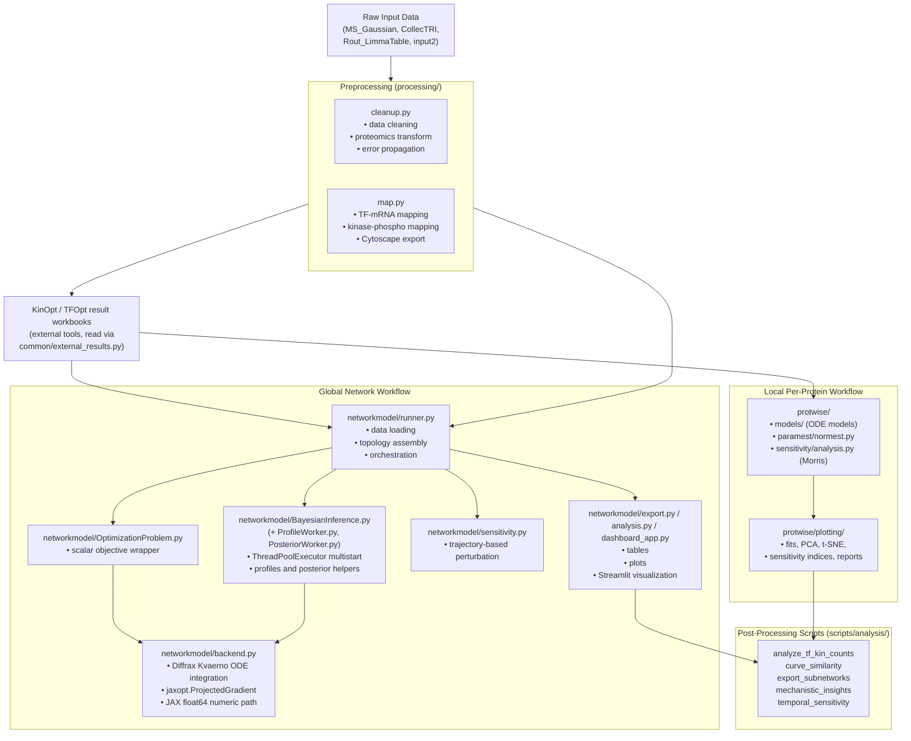

# Architecture and Data Flow

This page describes the high-level architecture of PhosKinTime and how data flows through the
pipeline from raw experimental inputs to final outputs.

---

## Two Modeling Stacks

PhosKinTime provides two complementary but distinct modeling workflows:

### Local (per-protein) workflow

Fits individual protein ODE models to per-site phosphoproteomics time series. Each protein/site
is handled independently. Parameter estimation (`protwise/paramest/normest.py`) uses the JAX/Diffrax
optimizer and solver helpers of `networkmodel/backend.py`.

Packages involved: `processing`, `protwise` (`models`, `paramest`, `sensitivity`, `steady`,
`plotting`, `knockout`, `runner`).

KinOpt and TFOpt are separate tools. Their result workbooks are inputs to this workflow and to the
global workflow; see [External tools](external_tools.md).

### Global (network-scale) workflow

Solves a coupled ODE system spanning all genes, proteins, and kinases simultaneously. Calibrated
against multi-omics time series (protein, mRNA, phospho). Uses JAX/JAXopt for deterministic scalar optimization and Diffrax Kvaerno solvers for ODE integration. The objective is mode-aware and includes only available mRNA, protein, and phospho observations.

Packages involved: `processing`, `networkmodel`, `networkpruning`, `common` (including `common/frechet`).

---

## Data Flow Diagram



> **Note:** The `all` CLI command runs `prep → check KinOpt/TFOpt result files → model` only. It
> does not run KinOpt or TFOpt, and it does **not** invoke `networkmodel`. Run `pixi run networkmodel` separately after
> the local pipeline completes.

---

## Key Package Roles

| Package | Role |
|---|---|
| `processing/` | Raw data cleaning and network mapping |
| `protwise/models/` | Per-protein ODE definitions and solvers |
| `protwise/paramest/` | Parameter estimation (`normest.py`) |
| `protwise/sensitivity/` | Morris sensitivity analysis (local ODE models) |
| `protwise/steady/` | Steady-state initial condition computation |
| `protwise/plotting/` | Static publication-ready plots and HTML reports |
| `protwise/knockout/` | Knockout / perturbation analysis |
| `protwise/runner/` | Entry point of the per-protein workflow (`python -m protwise.runner.main`) |
| `networkmodel/` | Network-scale coupled ODE simulation and calibration |
| `networkpruning/` | Network preprocessing and pruning helpers |
| `common/frechet/` | Discrete Fréchet distance metric (Numba JIT) |
| `common/` | Shared helpers: result-directory provenance (`results.py`), the KinOpt/TFOpt result-file contract (`external_results.py`), utilities (`utils/`) |
| `config/` | CLI, constants, logging, shared configuration helpers |
| `config_loader.py` | Root-level `config.toml` loader (LRU-cached) |
| `dashboard/` | Unified Streamlit dashboard (`pixi run dashboard`) |
| `scripts/` | Stand-alone post-processing and analysis utilities |

---|---|
| `processing/` | Raw data cleaning and network mapping |
| `models/` | Per-protein ODE definitions and solvers |
| `paramest/` | Parameter estimation (`normest.py`) |
| `sensitivity/` | Morris sensitivity analysis (local ODE models) |
| `steady/` | Steady-state initial condition computation |
| `plotting/` | Static publication-ready plots and HTML reports |
| `networkmodel/` | Network-scale coupled ODE simulation and calibration |
| `frechet/` | Discrete Fréchet distance metric (Numba JIT) |
| `knockout/` | Network knockout / perturbation analysis |
| `config/` | CLI, constants, logging, shared configuration helpers |
| `config_loader.py` | Root-level `config.toml` loader (LRU-cached) |
| `scripts/` | Stand-alone post-processing and analysis utilities |

---

## Local vs Global: When to Use Which

| Goal | Use |
|---|---|
| Fit kinase → phosphosite contributions | External KinOpt tool ([External tools](external_tools.md)) |
| Fit TF → mRNA regulation | External TFOpt tool ([External tools](external_tools.md)) |
| Fit individual protein phosphorylation dynamics | Local workflow (`protwise`) |
| System-level network simulation | `networkmodel` (requires KinOpt/TFOpt result workbooks) |
| Sensitivity of individual ODE parameters | `protwise/sensitivity/analysis.py` |
| Sensitivity of global coupled model parameters | `networkmodel/sensitivity.py` |
| Interactive exploration of results | Unified dashboard (`pixi run dashboard`); legacy networkmodel dashboard (`pixi run network-dashboard`) |

---

## Directory Structure Summary

```
phoskintime/
├── config/             CLI, constants, logging setup
├── config_loader.py    Shared config.toml loader
├── config.toml         Project configuration
├── processing/         Data preprocessing and mapping
├── protwise/           Per-protein ODE workflow (models, paramest, sensitivity, steady, plotting, knockout, runner)
├── networkmodel/       Global coupled ODE pipeline
├── networkpruning/     Network preprocessing and pruning
├── common/             Shared helpers (Fréchet distance, result provenance, external result-file contract)
├── global_model/       Compatibility shim for old pickled dashboard bundles
├── dashboard/          Unified Streamlit dashboard
├── scripts/            Stand-alone analysis, export, figure and app scripts
├── notebooks/          Tutorial notebooks
├── examples/           Small example scripts
├── tests/              Test suite
└── docs/               Documentation sources
```

See also [Repository layout](../repository/layout.md).

---

## Technical Debt Notes

- **Configuration overlap**: `config_loader.py` and `networkmodel/config.py` both expose sections of
  `config.toml`. `networkmodel/config.py` reads the file through `config_loader.load_config_toml()`
  but keeps its own module-level constants.
